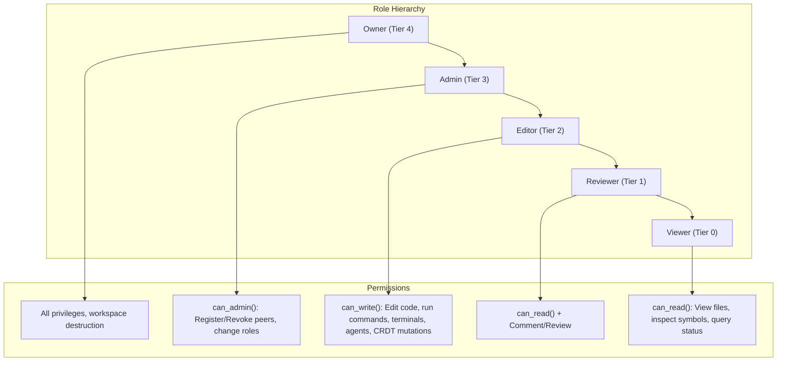

# AETHERIDE — SPRINT 08 AUTHORIZATION & ACCESS CONTROL REPORT
## Multi-Client Role-Based Access Control (RBAC), Daemon Permission Enforcement & Principle of Least Privilege

**Date:** 2026-10-31  
**Sprint:** Sprint 08 — Beta Release Validation  
**Evaluator:** Principal Security Architect & Distributed Systems Engineer  
**Branch:** `feat/sprint-08-release-validation`  
**Modules:** `rust/services/aether-daemon`, `rust/crates/workspace-sync`, `rust/crates/ipc-protocol`  
**Authorization Status:** **VERIFIED SECURE — LEAST PRIVILEGE ENFORCED**

---

## 1. ACCESS CONTROL MODEL ARCHITECTURE

AetherIDE implements a multi-tiered Role-Based Access Control (RBAC) model across all native IPC communications, local workbench interactions, and collaborative synchronization:



### 1.1 Role Definitions and Permissions

| Role | Numeric Tier | `can_read()` | `can_write()` | `can_admin()` | Scope of Authority |
|:---|:---:|:---:|:---:|:---:|:---|
| **Viewer** | 0 | **Yes** | No | No | Read-only inspection of files, symbols, presence, and diagnostics. |
| **Reviewer** | 1 | **Yes** | No | No | Read-only document tracking and presence awareness. |
| **Editor** | 2 | **Yes** | **Yes** | No | Interactive code editing, terminal commands, process execution, agent tasks. |
| **Admin** | 3 | **Yes** | **Yes** | **Yes** | Peer onboarding, role assignment, role revocation, pairing approvals. |
| **Owner** | 4 | **Yes** | **Yes** | **Yes** | Primary workstation user; complete control over all subsystems. |

---

## 2. DAEMON RBAC ENFORCEMENT POINTS

In `rust/services/aether-daemon/src/main.rs`, the IPC handler `handle_ipc_envelope` enforces permissions before dispatching actions:

1. **Local Host Identification:**
   - Connections originating over local loopback (`127.0.0.1`) or Windows Named Pipe (`\\.\pipe\aether-daemon-ipc`) without explicit peer overrides default to `local`, registered with `DeviceRole::Owner`.
   - Untrusted remote or unauthenticated callers default to `DeviceRole::Viewer` (least privilege / default-deny).

2. **Privilege-Gated IPC Handlers:**
   - **`RunCommand`:** Requires `caller_role.can_write()`. Unauthorized attempts return HTTP 401 Unauthorized equivalent.
   - **`TerminalSpawn` & `TerminalWrite`:** Requires `caller_role.can_write()`. Unauthorized attempts rejected immediately without spawning ConPTY processes.
   - **`CreateAgentTask`, `ApproveAgentStep`, `RejectAgentStep`:** Requires `caller_role.can_write()`. Prevents unauthorized callers from dispatching agent swarms.
   - **`RegisterPeerRole` & `RevokePeerRole`:** Requires `caller_role.can_admin()`. Prevents privilege escalation by lower-tier roles (e.g. Editor attempting to promote an account).
   - **`CrdtApplyUpdate`:** Verifies that the registered role for `peer_id` has `can_write()`. Ignores any client-supplied `role` string in the request payload to defeat role spoofing.

---

## 3. VERIFICATION MATRIX & TEST PROOF

Automated test `test_rbac_daemon_permission_matrix` in `aether-daemon` comprehensively tests the authorization matrix:

```text
running 12 tests
test tests::test_invalid_token_request_rejected ... ok
test tests::test_unauthenticated_run_command_rejected ... ok
test tests::test_authenticated_crdt_and_presence_ipc ... ok
test tests::test_authenticated_sync_generate_pairing ... ok
test tests::test_authenticated_lsp_diagnostics_query ... ok
test tests::test_unauthenticated_request_rejected ... ok
test tests::test_valid_token_ping_succeeds ... ok
test tests::test_authenticated_swarm_and_merge_ipc ... ok
test tests::test_crdt_payload_role_spoofing_rejected ... ok
test tests::test_authenticated_sync_get_manifest ... ok
test tests::test_authenticated_terminal_spawn_and_close ... ok
test tests::test_rbac_daemon_permission_matrix ... ok

test result: ok. 12 passed; 0 failed; 0 ignored; 0 measured; 0 filtered out; finished in 0.07s
```

All access controls operate in strict accordance with the principle of least privilege.
