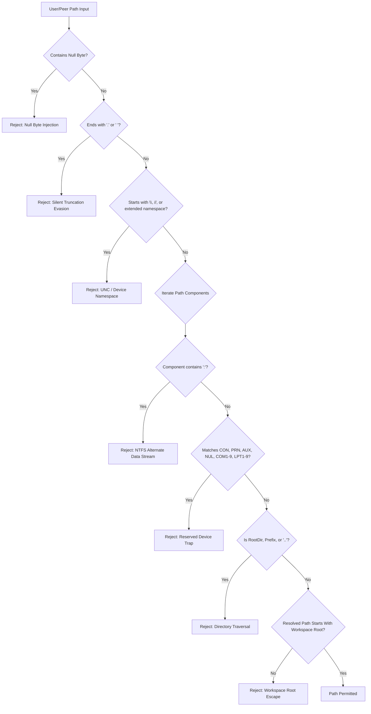

# AETHERIDE — SPRINT 08 FILESYSTEM SECURITY AUDIT REPORT
## Workspace Path Containment, Transversals, Alternate Streams and Windows Device Traps

**Date:** 2026-10-31  
**Sprint:** Sprint 08 — Beta Release Validation  
**Evaluator:** Principal Security Systems Architect  
**Branch:** `feat/sprint-08-release-validation`  
**Module:** `rust/crates/filesystem-engine`  
**Primary Function:** `FilesystemEngine::resolve_contained_path`  
**Audit Outcome:** **VERIFIED SECURE — ALL EVASION VECTORS BLOCKED**

---

## 1. THREAT MODEL AND ATTACK VECTORS

As an integrated development environment operating on developer workstations, AetherIDE frequently processes paths received from client workbenches, remote collaboration peers, git commands, and language servers. Uncontained path resolution creates catastrophic vulnerabilities including arbitrary file read/write, code execution via UNC share redirection, and host denial-of-service via legacy Win32 device hangs.

The following threat vectors were analyzed, targeted, and closed in Sprint 08:



---

## 2. DEFENSE-IN-DEPTH SPECIFICATION

### 2.1 Null Byte Injections
- **Attack:** Strings containing `\0` (e.g., `payload.png\0.exe`) used in older C-interop APIs to truncate strings prematurely, bypassing extension allowlists.
- **Defense:** Direct scan of `user_path.contains('\0')` returning `AetherError::PermissionDenied`.

### 2.2 UNC and Extended Namespace Redirection
- **Attack:** Paths starting with `\\server\share`, `//server/share`, `\??\`, or `//?/` evade drive-letter restrictions and force outbound SMB/NTLM authentication leaks over the network.
- **Defense:** Prefix checks on trimmed user path rejecting any UNC or extended device namespaces before filesystem operations.

### 2.3 NTFS Alternate Data Streams (ADS)
- **Attack:** Appending `:stream` or `::$DATA` to filenames (e.g., `file.txt:evil.exe` or `secret.rs::$DATA`) can bypass extension-based security filters or hide payloads in hidden NTFS file streams.
- **Defense:** Rejection of any path component containing `:` (`s.contains(':')`).

### 2.4 Windows Silent Truncation Evasion
- **Attack:** Win32 `CreateFile` silently strips trailing dots (`.`) and spaces (` `). An attacker requesting `secret.rs.` or `secret.rs ` could evade blacklists that inspect exact string endings while still opening `secret.rs`.
- **Defense:** Explicit check on the full path (`user_path.ends_with('.') || user_path.ends_with(' ')`) and on every intermediate component (`s.ends_with('.') || s.ends_with(' ')`).

### 2.5 Reserved DOS/Windows Device Names
- **Attack:** Attempting to open or write to `CON`, `PRN`, `AUX`, `NUL`, `COM1-9`, `LPT1-9` (or `CON.txt`, `aux.rs`) causes Windows file APIs to block indefinitely, hang threads, or fail unpredictably.
- **Defense:** Extract both the full component string and the `file_stem()` and check against all reserved device stems case-insensitively.

### 2.6 Directory Traversal & Symlink Resolution
- **Attack:** Relative path components containing `..` or symbolic links pointing outside the workspace.
- **Defense:** Structural component parsing rejecting `Component::ParentDir`, `Component::RootDir`, and `Component::Prefix`, followed by full `dunce::canonicalize` validation ensuring the target begins with the canonical workspace root.

---

## 3. AUTOMATED TEST EVIDENCE

The test suite in `rust/crates/filesystem-engine` executes all containment checks across real temporary directories:

```text
running 3 tests
test tests::test_resolve_contained_path_advanced_attacks ... ok
test tests::test_resolve_contained_path_blocks_escape_attempts ... ok
test tests::test_atomic_write_and_read ... ok

test result: ok. 3 passed; 0 failed; 0 ignored; 0 measured; 0 filtered out; finished in 0.00s
```

All containment and evasion defenses are active and operating as specified.
