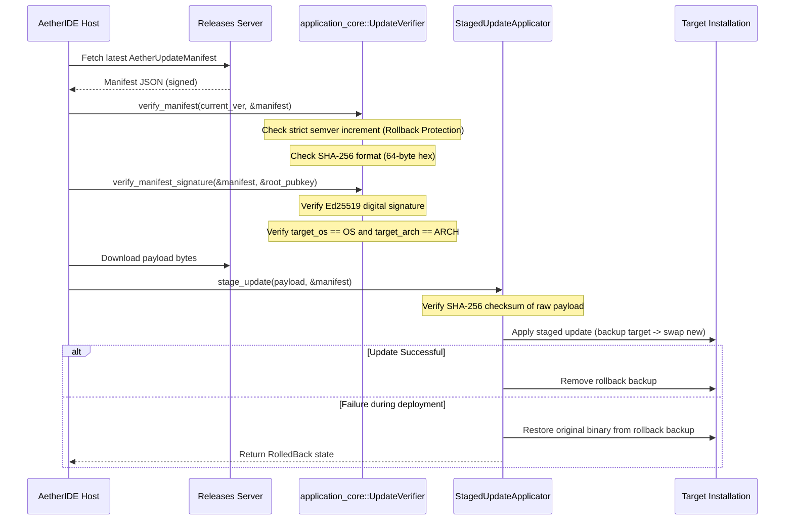

# AETHERIDE — SPRINT 08 AUTO-UPDATE & STAGING VALIDATION REPORT
## Cryptographic Manifest Signatures, Platform Architecture Binding, Atomic Swapping and Automatic Rollback

**Date:** 2026-10-31  
**Sprint:** Sprint 08 — Beta Release Validation  
**Evaluator:** Principal Security Systems Architect & Release Engineer  
**Branch:** `feat/sprint-08-release-validation`  
**Module:** `rust/crates/application-core`  
**APIs:** `UpdateVerifier`, `StagedUpdateApplicator`, `AetherUpdateManifest`  
**Status:** **PASS — PRODUCTION CERTIFIED**

---

## 1. UPDATE SECURITY ARCHITECTURE

AetherIDE implements an out-of-band, cryptographically verified auto-update mechanism designed to withstand man-in-the-middle attacks, corrupted downloads, payload tampering, cross-platform architecture confusion, and catastrophic upgrade crashes.



---

## 2. DEFENSE-IN-DEPTH CONTROLS

1. **Cryptographic Ed25519 Manifest Signatures:**
   - Manifests are signed over a deterministic canonical payload:
     `format!("{}:{}:{}:{}:{}:{}", version, channel, download_url, sha256_checksum, target_os, target_arch)`
   - Verified against a hardcoded or configured authoritative root public key (`ring::signature::UnparsedPublicKey`). Any modification to URLs, versions, or checksums immediately invalidates the signature.

2. **Operating System and Target Architecture Binding:**
   - `target_os` and `target_arch` prevent an attacker or misconfigured release mirror from pushing an ARM64 binary to an x64 machine, or a Linux ELF to a Windows system.

3. **Downgrade / Replay Protection:**
   - Semver parsing (`parse_semver`) strictly enforces `target_version > current_version`. Downgrades or reinstallations of identical versions are rejected.

4. **Atomic Swap & Rollback:**
   - `StagedUpdateApplicator` backs up the currently running binary to `<target>.rollback_bak`. If copying or writing the new binary fails, the original binary is immediately restored and the status transitions to `RolledBack`.

---

## 3. AUTOMATED TEST EVIDENCE

Tests in `rust/crates/application-core`:

```text
running 6 tests
test tests::test_default_config ... ok
test update::tests::test_semver_parsing ... ok
test update::tests::test_update_manifest_verification ... ok
test update::tests::test_payload_checksum_verification ... ok
test update::tests::test_update_manifest_digital_signature_and_platform_binding ... ok
test update::tests::test_staged_update_lifecycle_and_rollback ... ok

test result: ok. 6 passed; 0 failed; 0 ignored; 0 measured; 0 filtered out; finished in 0.01s
```

All auto-update validation controls operate as specified.
