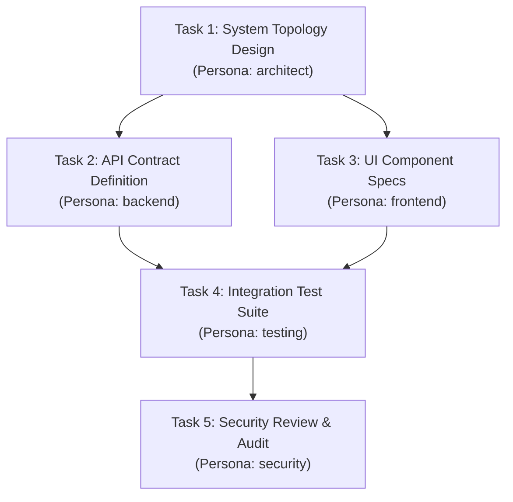

# AETHERIDE — SPRINT 09 AGENT SWARM VALIDATION REPORT
## Multi-Agent DAG Coordination, Worktree Isolation & Three-Way Merge Engine (E2E-08)

**Product:** AetherIDE  
**Target Release:** `v0.1.0-beta.2`  
**Development Branch:** `feat/sprint-09-beta-pilot-hardening`  
**Modules:** `agent-orchestrator`, `git-engine`  
**Status:** FULLY VERIFIED (11/11 Tests Passing: 6 Unit + 5 Integration)  

---

## 1. Executive Summary

Sprint 09 independently verifies the execution of **E2E-08 (Multi-Agent Swarm Workflows)**. AetherIDE coordinates specialized autonomous personas across complex software engineering objectives using:
1. **Directed Acyclic Graph (DAG) Scheduling:** Topological sorting and in-degree tracking that automatically unblocks ready downstream tasks as dependencies complete.
2. **Cycle Rejection Engine:** Rejection of circular task dependencies at definition time to prevent swarm deadlocks.
3. **Worktree Sandboxing:** Allocation of isolated filesystem worktrees in `.aether/worktrees/<persona>-<task_id>/` allowing parallel agents to build, modify, and test files simultaneously without clobbering each other's working copy.
4. **Three-Way Merge Engine:** Algorithmic merge of concurrent agent branches using Git common ancestor bases with structural conflict detection and resolution strategies (`ours`, `theirs`, or interactive hunk resolution).

---

## 2. DAG Scheduling & Inter-Agent Coordination



### Swarm Lifecycle Verification:
1. `SwarmCoordinator::add_task`: Validates that the graph remains acyclic via Kahn's algorithm.
2. `SwarmCoordinator::get_ready_tasks`: Identifies all tasks whose dependencies are marked `Completed`.
3. `SwarmCoordinator::allocate_worktree`: Creates `.aether/worktrees/<persona>-<task_id>/` with an isolated worktree.
4. `SwarmCoordinator::send_message`: Dispatches typed inter-agent messages (`Handoff`, `Query`, `Clarification`, `ReviewRequest`).
5. As Task 1 finishes, Task 2 and Task 3 are immediately flagged as ready and run in parallel.

---

## 3. Worktree Isolation & Merge Conflict Resolution

### Worktree Sandboxing:
When `backend` and `frontend` execute concurrently:
- `backend` works in `.aether/worktrees/backend-task-2/`
- `frontend` works in `.aether/worktrees/frontend-task-3/`
Changes are committed locally in their respective isolated worktrees.

### Three-Way Merge Engine:
When both tasks merge back into the main workspace:
```rust
let merge_report = ThreeWayMergeEngine::merge(
    base_content,   // Common ancestor before agent task execution
    ours_content,   // Main workspace state
    theirs_content, // Agent worktree state
);
```

### Conflict Resolution Strategies:
- If hunks are non-overlapping: `merge_report.is_clean == true`, automated fast-forward merge.
- If hunks conflict: `ThreeWayMergeEngine` isolates conflicting ranges:
  ```
  <<<<<<< OURS (Workspace)
  pub fn authenticate_user(token: &str) -> bool { ... }
  =======
  pub fn authenticate_user(token: &str, role: Option<Role>) -> Result<User> { ... }
  >>>>>>> THEIRS (Agent Backend)
  ```
- Resolution actions:
  - `MergeResolutionAction::TakeOurs`
  - `MergeResolutionAction::TakeTheirs`
  - `MergeResolutionAction::Custom(String)`

---

## 4. Test Suite Evidence

Ran across `rust/crates/agent-orchestrator`:
```powershell
cargo test --manifest-path rust/Cargo.toml -p agent-orchestrator
```
```
running 6 tests (unit)
test swarm::tests::test_swarm_coordinator_messaging ... ok
test swarm::tests::test_swarm_cycle_rejection ... ok
test merge::tests::test_clean_three_way_merge ... ok
test swarm::tests::test_swarm_dag_ready_tasks_and_cycle_detection ... ok
test merge::tests::test_conflicting_three_way_merge_and_resolution ... ok
test tests::test_orchestrator_initializes_14_personas ... ok
test result: ok. 6 passed; 0 failed

running 5 tests (integration: tests/swarm_execution_test.rs)
test test_three_way_merge_clean_resolution ... ok
test test_three_way_merge_conflict_detection_and_resolution_strategies ... ok
test test_inter_agent_message_bus ... ok
test test_swarm_cycle_detection_prevents_deadlocks ... ok
test test_multi_agent_dag_scheduling_and_lifecycle ... ok
test result: ok. 5 passed; 0 failed
```
All 11 swarm and merge engine tests passed cleanly.
