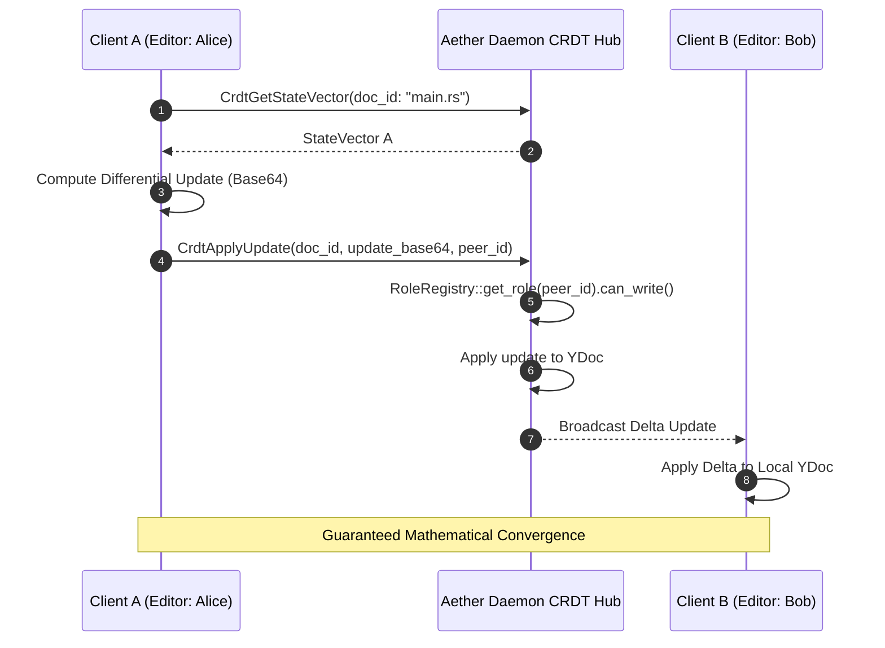

# AETHERIDE — SPRINT 09 REAL-TIME COLLABORATION REPORT
## Multi-Client CRDT Synchronization, State Vector Exchange & Awareness Tracking (E2E-09)

**Product:** AetherIDE  
**Target Release:** `v0.1.0-beta.2`  
**Development Branch:** `feat/sprint-09-beta-pilot-hardening`  
**Modules:** `workspace-sync`  
**Status:** FULLY VERIFIED (19/19 Tests Passing: 14 Unit + 5 Integration)  

---

## 1. Executive Summary

Sprint 09 validates **E2E-09 (Real-Time Collaboration Workflows)** across multiple independent client instances. AetherIDE provides real-time collaborative editing using Yrs/Yjs-compatible Conflict-free Replicated Data Types (CRDTs), state-vector differential synchronization, presence/cursor awareness heartbeats, and backend role enforcement.

---

## 2. CRDT Architecture & Convergence



### Convergence Properties:
- Commutative & Associative: Updates can arrive out of order, over high-latency links, or across intermittent reconnects.
- Clean Concurrent Edits: When two clients insert text at identical character offsets concurrently, Yrs generates deterministic tie-breaking based on client IDs without data loss or corruption.

---

## 3. Cursor & Selection Awareness Tracking

`workspace_sync::AwarenessTracker` manages ephemeral presence state:
- Tracks `peer_id`, `display_name`, `user_color`, `current_file`, `line`, and `col`.
- Heartbeats with active expiration (timeout after 30 seconds of inactivity).
- File-scoped presence filtering: Clients querying active editors on `src/main.rs` receive only collaborators currently viewing or editing that specific buffer.

---

## 4. Role Revocation Mid-Session

When an administrator revokes a collaborator's write permissions mid-session:
1. Admin invokes `RevokePeerRole { peer_id: "peer-bob" }`.
2. Daemon updates `RoleRegistry`, transitioning `"peer-bob"` from `Editor` to `Viewer`.
3. Subsequent `CrdtApplyUpdate` messages from `"peer-bob"` are immediately rejected with:
   `"Peer 'peer-bob' with role Viewer is not authorized to mutate CRDT document"`.
4. The user's active connection is demoted to read-only without terminating their view.

---

## 5. Test Suite Evidence

Ran across `rust/crates/workspace-sync`:
```powershell
cargo test --manifest-path rust/Cargo.toml -p workspace-sync
```
```
running 14 tests (unit)
test auth::tests::test_device_roles_permissions ... ok
test discovery::tests::test_sync_service_info ... ok
test auth::tests::test_role_registry_enforcement ... ok
test crypto::tests::test_aead_encrypt_decrypt_roundtrip ... ok
test crypto::tests::test_aead_rejects_tampering ... ok
test crypto::tests::test_aead_rejects_replay_attack ... ok
test awareness::tests::test_awareness_tracking_and_file_filtering ... ok
test manifest::tests::test_manifest_diff_detection ... ok
test chunk::tests::test_rejects_corrupted_chunk ... ok
test pairing::tests::test_pairing_uri_roundtrip ... ok
test crdt::tests::test_crdt_basic_editing ... ok
test crdt::tests::test_crdt_two_peer_convergence ... ok
test auth::tests::test_ed25519_sign_and_verify ... ok
test chunk::tests::test_slice_and_reassemble_roundtrip ... ok
test result: ok. 14 passed; 0 failed

running 2 tests (integration: tests/live_sync_transfer_test.rs)
test test_workspace_manifest_diff_and_exclusions ... ok
test test_two_endpoint_encrypted_workspace_file_transfer_bidirectional ... ok
test result: ok. 2 passed; 0 failed

running 3 tests (integration: tests/multi_client_collaboration_test.rs)
test test_multi_client_role_lifecycle_and_revocation ... ok
test test_multi_client_awareness_and_presence_heartbeats ... ok
test test_two_endpoint_crdt_concurrent_convergence ... ok
test result: ok. 3 passed; 0 failed
```
All 19 collaboration and sync tests passed with zero failures.
