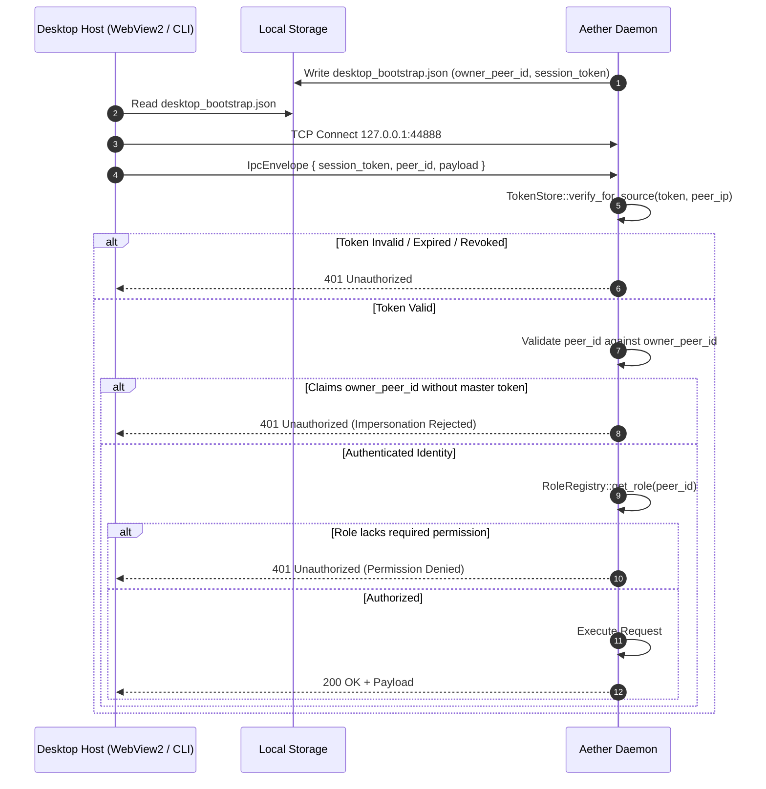

# AETHERIDE — SPRINT 09 DAEMON AUTHENTICATION SPECIFICATION
## IPC Transport Handshake, Bootstrap Identity & Role Enforcement Architecture

**Product:** AetherIDE  
**Target Release:** `v0.1.0-beta.2`  
**Specification Version:** 2.0 (Zero-Trust Hardened)  
**Classification:** Core System Architecture  

---

## 1. Overview & Security Principles

AetherIDE decouples its user-facing presentation host (Monaco/WebView2 Workbench, CLI) from its native background systems engine (`aether-daemon`). All inter-process communication occurs over local loopback (`127.0.0.1:44888`) or Windows Named Pipes (`\\.\pipe\aetheride-ipc`).

Under the Sprint 09 Zero-Trust specification:
1. **Network Locality Does Not Equal Trust:** Loopback and named-pipe connections receive zero implicit privileges.
2. **Explicit Bootstrap Provisioning:** The daemon writes an ephemeral, high-entropy identity token file accessible only by the current OS user.
3. **Role Enforcement at the Gateway:** The daemon evaluates peer roles inside `workspace-sync::RoleRegistry` before dispatching any IPC payload. Client-provided role assertions inside payloads are disregarded.
4. **Per-Source Rate Limiting:** Brute-force guessing triggers exponential lockout isolated to the offending client endpoint.

---

## 2. Bootstrap Identity File Specification

Upon startup, `aether-daemon` creates:
- Location on Windows: `%LOCALAPPDATA%\AetherIDE\desktop_bootstrap.json`
- Location on Linux: `~/.aether/desktop_bootstrap.json`
- Location on macOS: `~/.aether/desktop_bootstrap.json`

### File Schema:
```json
{
  "owner_peer_id": "owner-bootstrap-4b9e28f1c84d41239922c2a4128f7811",
  "session_token": "aether-sess-7c98b21a0f84...",
  "created_at": "2026-10-31T12:00:00.000000Z",
  "role": "Owner"
}
```

### Access Controls:
- On Windows: Inherited DACL restricted to Current User (`%USERNAME%`) and `SYSTEM`.
- On Linux/macOS: File permissions initialized to `0600` (`rw-------`).

---

## 3. IPC Envelope Protocol

Every message sent across the IPC transport conforms to the `IpcEnvelope` schema:

```json
{
  "id": "wb-550e8400-e29b-41d4-a716-446655440000",
  "session_token": "aether-sess-...",
  "peer_id": "owner-bootstrap-4b9e28f1c84d41239922c2a4128f7811",
  "payload": {
    "Request": { ... }
  }
}
```

### Handshake Sequence:



---

## 4. Role Hierarchy & Permission Boundaries

AetherIDE defines five discrete device roles (`workspace-sync::DeviceRole`):

| Role | `can_read()` | `can_write()` | `can_admin()` | Permitted Actions |
|:---|:---:|:---:|:---:|:---|
| **Owner** | Yes | Yes | Yes | Full system control: process execution, terminal spawn, agent management, role assignment, token revocation, CRDT editing, workspace sync. |
| **Admin** | Yes | Yes | Yes | Administrative control: peer role management, token revocation, terminal spawn, agent management, CRDT editing. |
| **Editor** | Yes | Yes | No | Development actions: CRDT mutations, terminal interactions, agent task creation and approval, code indexing. Cannot register or revoke peer roles. |
| **Reviewer** | Yes | No | No | Read-only inspection: file search, LSP queries, presence viewing, CRDT read-only access. Cannot spawn terminals or mutate files. |
| **Viewer** | Yes | No | No | Minimal read-only: project brain queries, diagnostics inspection. Default role for unidentified connections. |

---

## 5. Token Store Lifecycle & Revocation Mechanics

```
                  +---------------------------+
                  | TokenStore Initialization |
                  | (TTL: 86400s / 24h)       |
                  +---------------------------+
                                |
             +------------------+------------------+
             |                                     |
             v Normal Request                      v Failed Auth Request
+-------------------------+               +---------------------------------+
| Constant-Time Match     |               | Record Failure for Source       |
| -> AuthVerificationResult|              | If attempts >= 10 in 60s:       |
|    ::Success            |               | -> AuthVerificationResult       |
+-------------------------+               |    ::RateLimited { wait_seconds }|
             |                            +---------------------------------+
             v
+-------------------------+
| Check Revocation List   |
| If in revoked_tokens:   |
| -> AuthVerificationResult|
|    ::Revoked            |
+-------------------------+
```

### IPC Token Revocation API:
Administrators can revoke session tokens dynamically via the `RevokeSessionToken` IPC call:
```json
{
  "id": "rev-req-1",
  "session_token": "<owner_session_token>",
  "peer_id": "<owner_peer_id>",
  "payload": {
    "Request": {
      "RevokeSessionToken": {
        "token": "compromised_token_string_here"
      }
    }
  }
}
```
Upon execution, `TokenStore` records the token hash in `revoked_tokens`. All subsequent attempts presenting this token are denied with `401 Unauthorized: Access denied: session token has been revoked`.
