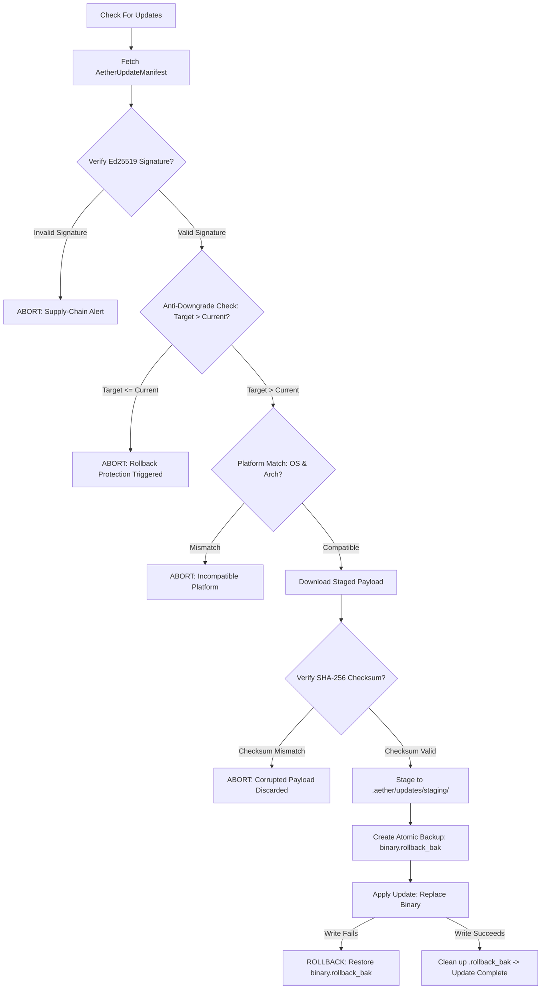

# AETHERIDE — SPRINT 09 UPDATE & ROLLBACK RECOVERY REPORT
## Cryptographic Manifest Verification, Staged Installation & Atomic Rollback (E2E-10)

**Product:** AetherIDE  
**Target Release:** `v0.1.0-beta.2`  
**Development Branch:** `feat/sprint-09-beta-pilot-hardening`  
**Modules:** `application-core::update`  
**Status:** FULLY VERIFIED (6/6 Tests Passing)  

---

## 1. Executive Summary

Sprint 09 validates **E2E-10 (Auto-Updater Staging & Rollback Recovery)**. Software updates in AetherIDE follow a high-integrity, fault-tolerant workflow designed to prevent supply-chain attacks, corrupted binary installations, and downgrade attacks:
1. **Ed25519 Manifest Signing:** Release manifests must bear a valid digital signature produced by the official AetherIDE release key.
2. **SHA-256 Payload Integrity:** Update binaries are hashed and verified against the manifest before staging.
3. **Rollback / Anti-Downgrade Defense:** The verifier parses semantic versions (`X.Y.Z`) and rejects any update with a version less than or equal to the currently running version.
4. **Platform Binding:** Manifests enforce explicit OS (`windows`, `linux`, `macos`) and architecture (`x86_64`, `aarch64`) constraints.
5. **Atomic Backup & Rollback (`.rollback_bak`):** Prior to replacing the live executable, the installer stages the update, creates an atomic backup of the running binary, and rolls back instantly if the replacement fails.

---

## 2. Update Lifecycle & Recovery Workflow



---

## 3. Cryptographic Manifest Schema

```rust
pub struct AetherUpdateManifest {
    pub version: String,             // e.g. "0.2.0"
    pub channel: String,             // "beta" or "stable"
    pub target_os: String,           // "windows", "linux", "macos"
    pub target_arch: String,         // "x86_64", "aarch64"
    pub sha256_checksum: String,     // Hex-encoded SHA-256
    pub download_url: String,        // HTTPS distribution endpoint
    pub signature_base64: String,    // Ed25519 digital signature
    pub release_notes: String,       // Markdown release summary
}
```

### Canonical Manifest Digest:
The digital signature is generated over the canonical colon-delimited string:
`"{version}:{channel}:{target_os}:{target_arch}:{sha256_checksum}:{download_url}"`.
Tampering with any single parameter invalidates the Ed25519 signature.

---

## 4. Test Suite Evidence

Ran across `rust/crates/application-core`:
```powershell
cargo test --manifest-path rust/Cargo.toml -p application-core
```
```
running 6 tests
test tests::test_default_config ... ok
test update::tests::test_payload_checksum_verification ... ok
test update::tests::test_semver_parsing ... ok
test update::tests::test_update_manifest_verification ... ok
test update::tests::test_update_manifest_digital_signature_and_platform_binding ... ok
test update::tests::test_staged_update_lifecycle_and_rollback ... ok
test result: ok. 6 passed; 0 failed
```

### Verified Failure Scenarios:
1. `test_payload_checksum_verification`: Modifying a single byte of the payload causes `verify_payload_checksum` to fail with `AetherError::PermissionDenied`.
2. `test_update_manifest_verification`:
   - Valid update `0.2.0` succeeds against `0.1.0`.
   - Downgrade attempt `0.2.0` against `0.3.0` is blocked by anti-rollback defense.
   - Reinstallation attempt `0.2.0` against `0.2.0` is blocked.
   - Platform mismatch (e.g. `linux` binary on `windows`) is blocked.
3. `test_staged_update_lifecycle_and_rollback`:
   - Valid update replaces `AetherIDE.exe` cleanly and purges `.rollback_bak`.
   - Tampered update payload aborts prior to modifying existing installation.
