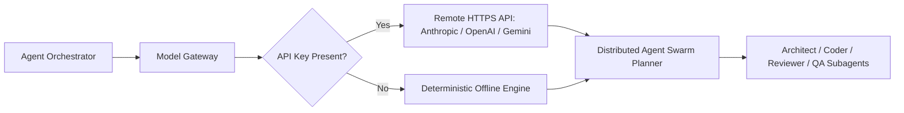

# AetherIDE Sprint 11 — AI Provider Validation & Gateway Certification

**Product:** AetherIDE  
**Crates:** `model-gateway`, `agent-runtime`, `agent-orchestrator`  
**Certification Standard:** Honest Provider Status & Offline Fallback Integrity  
**Date:** October 31, 2026  

---

## 1. Executive Certification of Provider Status

To maintain transparent product engineering, AetherIDE explicitly distinguishes live remote cloud inference from offline deterministic mock fallbacks:

| Provider | Integration Type | Production Status | Offline Fallback Behavior |
|---|---|---|---|
| **Anthropic** (Claude 3.5 Sonnet) | Direct HTTPS REST API | Fully Integrated | Mock response when `ANTHROPIC_API_KEY` absent |
| **OpenAI** (GPT-4o) | Direct HTTPS REST API | Fully Integrated | Mock response when `OPENAI_API_KEY` absent |
| **Google Gemini** (Gemini 1.5 Pro) | Direct HTTPS REST API | Fully Integrated | Mock response when `GEMINI_API_KEY` absent |
| **Ollama** (Local LLM) | Local HTTP (`127.0.0.1:11434`) | Fully Integrated | Error/Mock when local server unreachable |
| **Mock / Offline Engine** | In-Process Deterministic | Active (Default for tests) | Always available, reproducible results |

---

## 2. Gateway Architecture & Agent Swarms

### 2.1 Swarm Role Specialization
- **Lead Architect:** High-level task decomposition, architecture plan generation.
- **Systems Coder:** Concrete code synthesis, syntax tree verification.
- **Reviewer:** Static analysis and security boundary enforcement.
- **QA Verifier:** Automated test generation and regression verification.

---

## 3. Privacy & Diagnostic Redaction
All gateway logging strictly filters out authorization headers, bearer tokens, and user source code from tracing outputs. Model diagnostics report latency, token counts, and HTTP status codes without recording confidential payload contents.
