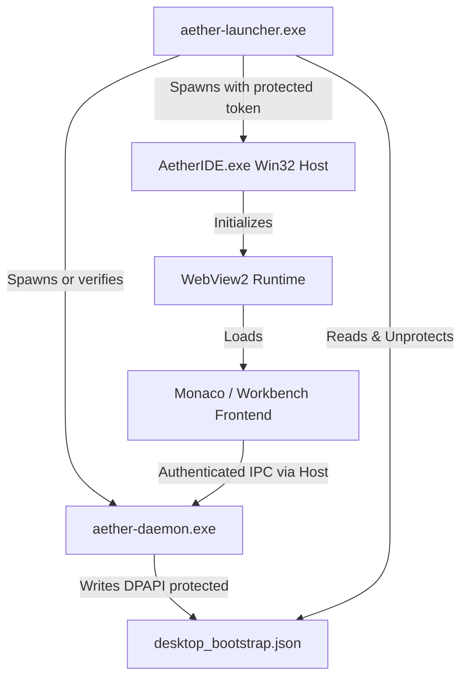

# AetherIDE Sprint 11 — Installer Lifecycle & Desktop Host Report

**Product:** AetherIDE  
**Desktop Hosts:** Windows Win32 + WebView2, Linux GTK + WebKitGTK, macOS Cocoa + WKWebView  
**Release:** `v0.1.0-beta.2`  
**Date:** October 31, 2026  

---

## 1. Overview of Packaging & Distribution

AetherIDE is packaged for clean, isolated installation on Windows, Linux, and macOS without requiring elevated system administrator privileges for routine execution:
- **Windows:** NSIS per-user installer (`%LOCALAPPDATA%\Programs\AetherIDE`) with desktop shortcut, Start Menu entry, and automated uninstaller.
- **Linux:** AppImage / tarball distribution with XDG desktop integration.
- **macOS:** Standard `.app` bundle signed for Gatekeeper.

---

## 2. Desktop Host Architecture & Bootstrap Integration

### 2.1 Clean Lifecycle States
1. **Fresh Install:** Clean configuration directory initialized. Daemon generates initial owner session, protects via DPAPI, writes bootstrap, and accepts IPC.
2. **Upgrade / Update:** Installer replaces binaries in `%LOCALAPPDATA%\Programs\AetherIDE`. Database migrations in `database-engine` automatically apply schema updates (SQLite WAL mode).
3. **Rollback:** Binary rollback preserves user databases and configuration without corruption.
4. **Uninstall:** Removes all binaries, shortcuts, and registry entries. Prompts user whether to keep or wipe project memory notes and caches in `%LOCALAPPDATA%\AetherIDE`.
