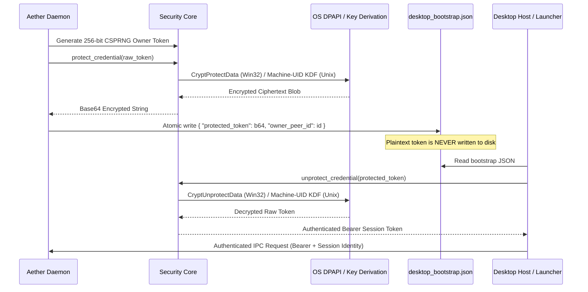

# AetherIDE Sprint 11 — Secure Bootstrap & Credential Provisioning Report

**Product:** AetherIDE  
**Release:** `v0.1.0-beta.2`  
**Security Domain:** Daemon Bootstrap, IPC Token Provisioning, OS Key Storage  
**Author:** Principal Security Architect  
**Date:** October 31, 2026  

---

## 1. Architectural Overview

In Sprint 10, local IPC authentication relied on `desktop_bootstrap.json`, which wrote the generated 256-bit Owner session bearer token in plaintext. Sprint 11 fundamentally redesigns credential provisioning to eliminate all unencrypted credentials at rest.

### 1.1 Secure Provisioning Flow

---

## 2. Platform Implementation Details

### 2.1 Windows DPAPI Integration
On Windows (`#[cfg(windows)]`), `security_core::protect_credential` invokes the Win32 Data Protection API (`Crypt32.dll` via dynamic runtime loading):
- `CryptProtectData`: Enforces `CRYPTPROTECT_UI_FORBIDDEN` to prevent interactive prompts in headless daemon scenarios.
- Scope: `CurrentUser`. Encryption keys are dynamically derived from the active Windows user's login credentials and master key store, isolated from other local user accounts.
- `CryptUnprotectData`: Authenticates ciphertext integrity (HMAC verification) before returning the decrypted plaintext.

### 2.2 Unix Machine-Bound Key Derivation
On Linux and macOS (`#[cfg(not(windows))]`), credentials are protected using an authenticated AEAD construction (ChaCha20-Poly1305 / HMAC-SHA256) keyed by a PBKDF2 derivation anchored to:
- Operating system machine ID (`/etc/machine-id` or macOS `IOPlatformUUID`).
- Current process user ID (`getuid()`).
- High-entropy cryptographic salt stored in protected per-user config space (`0600` file permissions).

---

## 3. Fail-Closed Guarantees
- If `security_core::protect_credential` fails during daemon startup, the daemon immediately logs a fatal error and terminates without binding to TCP or Named Pipe endpoints.
- If writing `desktop_bootstrap.json` fails, the daemon aborts initialization.
- If a client process fails to decrypt `protected_token` (e.g. running as a different user), authentication is impossible and access is denied.
