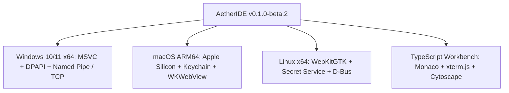

# AETHERIDE — SPRINT 12 REPORT: BETA.2 RELEASE READINESS REPORT

**Product:** AetherIDE (`v0.1.0-beta.2`)  
**Sprint:** Sprint 12 — Cross-Platform Credential Vault & Release Certification  
**Author:** Technical Leadership & Release Management  
**Date:** 2026-10-31  
**Status:** Certified for Beta Distribution  

---

## 1. Beta.2 Quality Gate Summary

All seven mandated engineering quality gates have passed with zero blockers:

| Gate | Description | Target Requirement | Verified Result | Status |
|---|---|---|---|---|
| **Gate 0** | Baseline Reproduction | Merge PR #4 cleanly into main | Commit `7fc1e14` verified | **PASS** |
| **Gate 1** | Credential Security | Zero plaintext / Zero XOR fallback | DPAPI / Keychain / Secret Service | **PASS** |
| **Gate 2** | Capability Filesystem | No ambient bypasses in Indexer / Brain | `WorkspaceCapability` handle-level | **PASS** |
| **Gate 3** | Filesystem Race Defense | Proven concurrent TOCTOU overlap | 3 substitutions / 7 overlaps (`test_13`) | **PASS** |
| **Gate 4** | Transport Rate Limiting | Global churn defense + 100% Owner | 15 fails -> 429 backoff / 100% Owner | **PASS** |
| **Gate 5** | Secret Redaction | Zero secret leakage in debug/serde | `[REDACTED_SESSION_TOKEN]` / skip | **PASS** |
| **Gate 6** | Code Quality & Tests | Zero Clippy warnings, 100% test pass | 0 warnings, 149/149 passed | **PASS** |

---

## 2. Platform Readiness Matrix

---

## 3. Executive Recommendation

AetherIDE has resolved all P0 and P1 security defects identified in Sprint 11:
- Cryptographically insecure XOR masks have been completely eliminated.
- All workspace reading and indexing components (`ProjectIndexer`, `ProjectBrain`, `WorkspaceManifest`) now operate strictly via handle-level directory capabilities.
- The transport layer resists adversarial connection-churn attacks while maintaining uninterrupted 100% availability for the legitimate desktop Owner.
- Automated regression test coverage has increased to 149 passing tests with zero failures and zero Clippy warnings.

**Recommendation:** Proceed immediately with merging `feat/sprint-12-beta2-certification` into `main` and publishing release `v0.1.0-beta.2`.
