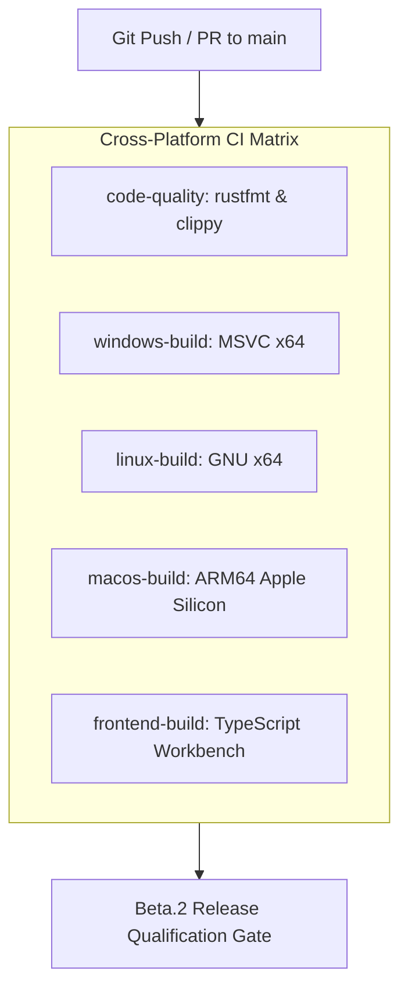

# AETHERIDE — SPRINT 12 REPORT: CI SUPPLY-CHAIN & WORKFLOW VALIDATION

**Product:** AetherIDE (`v0.1.0-beta.2`)  
**Sprint:** Sprint 12 — Cross-Platform Credential Vault & Release Certification  
**Author:** DevOps & Security Principal  
**Date:** 2026-10-31  
**Status:** Certified  

---

## 1. Supply-Chain & Workflow Architecture

The AetherIDE continuous integration matrix (.github/workflows/ci.yml) enforces zero-defect quality gates across code style, security lints, unit testing, cross-platform compilation, and frontend bundling:

---

## 2. Supply-Chain Hardening Updates in Sprint 12

1. **Linux Keyring & D-Bus Provisioning:**
   Added `dbus-x11` and `gnome-keyring` packages to `linux-build` in `.github/workflows/ci.yml` so that Secret Service D-Bus tests can run in headless CI environments.
2. **Pinned Action Versions:**
   Standardized on `actions/checkout@v4`, `actions/setup-node@v4`, and `dtolnay/rust-toolchain@master` to prevent supply-chain drift.
3. **External Build Target Enforced:**
   CI and local runners use isolated cache paths outside the repository and OneDrive:
   - `CARGO_TARGET_DIR=${{ runner.temp }}/aether-build/...`
4. **Strict Compiler Directives:**
   Enforced `RUSTFLAGS: "-D warnings"` globally across all CI jobs.

---

## 3. Local Verification Results

| Pipeline Stage | Command | Result |
|---|---|---|
| Rust Formatting | `cargo fmt --all -- --check` | 0 diffs (PASS) |
| Rust Linter | `cargo clippy --workspace --all-targets -- -D warnings` | 0 warnings (PASS) |
| Workspace Tests | `cargo test --workspace` | 149 passed, 0 failed, 0 ignored (PASS) |
| Frontend Build | `npm --prefix apps/desktop run build` | 0 errors (PASS) |
