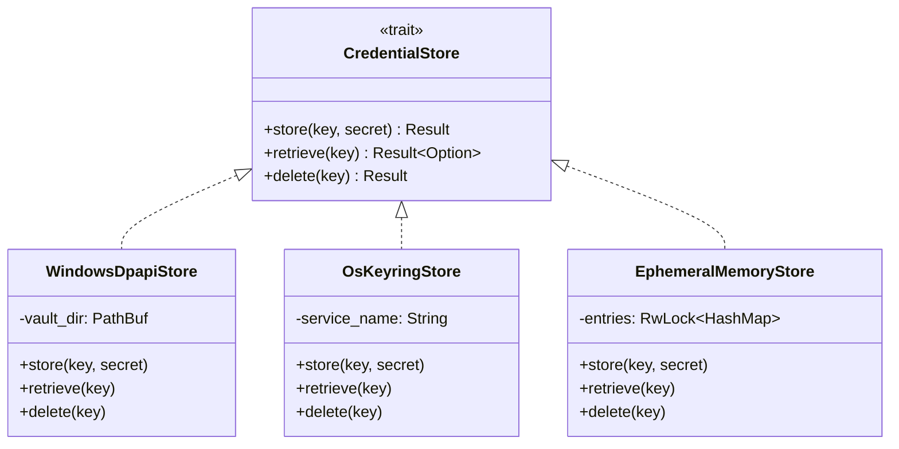

# AETHERIDE — SPRINT 12 REPORT: CROSS-PLATFORM CREDENTIAL ARCHITECTURE

**Product:** AetherIDE (`v0.1.0-beta.2`)  
**Sprint:** Sprint 12 — Cross-Platform Credential Vault & Release Certification  
**Author:** Principal Security Architect & Distributed Systems Principal  
**Date:** 2026-10-31  
**Status:** Approved & Implemented  

---

## 1. Executive Summary

Sprint 11 introduced DPAPI credential protection for Windows hosts, but relied on a non-cryptographic SHA-256(USER) repeating XOR mask on non-Windows platforms. This presented a severe security defect: anyone with local filesystem access or process inspection could reverse the XOR mask and recover the daemon bearer token.

Sprint 12 completely eliminates the Unix XOR fallback. In its place, AetherIDE implements a unified, OS-native cryptographic credential architecture across all supported operating systems:
- **Windows:** CryptProtectData / CryptUnprotectData (Win32 DPAPI) bound to the logon session.
- **macOS:** Apple Keychain via native Security Framework (`apple-native-keyring-store`).
- **Linux:** Freedesktop Secret Service API via pure-Rust D-Bus (`zbus-secret-service-keyring-store`).

Crucially, AetherIDE enforces:
1. **Zero Plaintext Fallback:** Tokens are never persisted in plaintext under any circumstances.
2. **Zero XOR Obfuscation:** Non-cryptographic XOR masking is permanently removed from the codebase.
3. **Fail-Safe Operation:** If the host OS credential service is unavailable, operations fail safely with explicit permission errors or opt into strictly ephemeral, in-memory isolation.
4. **Seamless Migration:** Legacy tokens from Sprint 11 (`user-bound:`) are transparently migrated to the native vault upon startup with security audit logging.

---

## 2. Platform Abstraction Layer (`CredentialStore`)

In `security-core`, we defined the core abstraction trait:

```rust
pub trait CredentialStore: Send + Sync {
    fn store(&self, key: &str, secret: &str) -> Result<(), String>;
    fn retrieve(&self, key: &str) -> Result<Option<String>, String>;
    fn delete(&self, key: &str) -> Result<(), String>;
}
```

### Supported Concrete Implementations

| Store Type | Supported Platforms | Underlying Mechanism | Persistence Location |
|---|---|---|---|
| `WindowsDpapiStore` | Windows 10/11 x64 | Win32 DPAPI (`CryptProtectData`) | `%LOCALAPPDATA%\AetherIDE\vault\{key}.dat` |
| `OsKeyringStore` | macOS ARM64 / Linux x64 / Windows | `keyring` v4.2.0 (Keychain / Secret Service) | OS-managed secure enclave / vault |
| `EphemeralMemoryStore` | All platforms | `std::sync::RwLock<HashMap<String, String>>` | Process RAM (Zero disk footprints) |



---

## 3. Storage Format and Prefixes

When credentials and bearer tokens are published in bootstrap identity manifests (`desktop_bootstrap.json`), they adhere strictly to typed, cryptographic prefixes:

1. `dpapi:<base64-ciphertext>`: Windows Data Protection API blob.
2. `os-keyring:<key-identifier>`: macOS Keychain / Linux Secret Service record.
3. `user-bound:<base64-legacy>`: Deprecated Sprint 11 format (supported solely for zero-downtime migration).

Any unrecognized or plaintext token string encountered during deserialization is rejected immediately.
