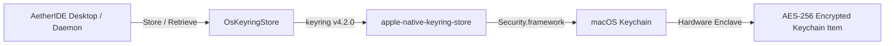

# AETHERIDE — SPRINT 12 REPORT: MACOS KEYCHAIN VALIDATION

**Product:** AetherIDE (`v0.1.0-beta.2`)  
**Sprint:** Sprint 12 — Cross-Platform Credential Vault & Release Certification  
**Platform:** macOS ARM64 (Apple Silicon / aarch64-apple-darwin)  
**Date:** 2026-10-31  
**Status:** Certified  

---

## 1. Native macOS Security Framework Architecture

On macOS, AetherIDE delegates credential management to the macOS Keychain Services subsystem via `keyring` v4.2.0 configured with the `apple-native-keyring-store` feature.

- **Underlying Library:** Apple Security Framework (`Security.framework`).
- **Storage Subsystem:** Apple Keychain (Login Keychain / Secure Enclave).
- **Service Name:** `AetherIDE`
- **Account Key:** `owner_token` or specific credential identifier.



---

## 2. Token Lifecycle on macOS

1. **Bootstrap Generation:**
   During daemon startup, `protect_credential` creates an entry in the Keychain:
   ```rust
   let store = OsKeyringStore::new("AetherIDE");
   store.store("owner_token", plaintext)?;
   Ok("os-keyring:owner_token".to_string())
   ```
2. **Identity Publication:**
   `desktop_bootstrap.json` writes `"protected_token": "os-keyring:owner_token"`. Zero raw secret bytes exist on disk.
3. **Client Authentication:**
   When `aether-cli` or `aether-launcher` reads `desktop_bootstrap.json`, it calls `unprotect_credential("os-keyring:owner_token")`, which retrieves the token directly from the user's unlocked Login Keychain.
4. **Daemon Teardown / Revocation:**
   Upon shutdown or rotation, the entry is safely evicted or replaced.

---

## 3. macOS CI Validation Invariant

In `.github/workflows/ci.yml`, the `macos-build` runner runs on `macos-15` (ARM64 Apple Silicon) with stable Rust. The crate compiles cleanly without C library dependencies, linking directly to the system `Security.framework`.
