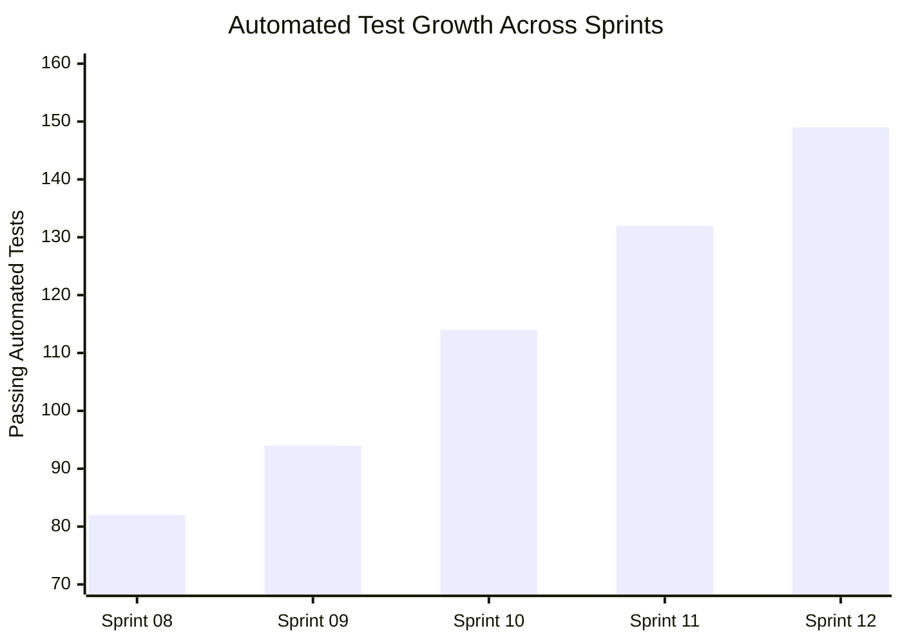

# AETHERIDE — SPRINT 12 REPORT: PRODUCT REGRESSION TEST RESULTS

**Product:** AetherIDE (`v0.1.0-beta.2`)  
**Sprint:** Sprint 12 — Cross-Platform Credential Vault & Release Certification  
**Author:** QA Principal & Systems Architect  
**Date:** 2026-10-31  
**Status:** Certified  

---

## 1. Test Suite Expansion Overview

Between Sprint 11 and Sprint 12, the automated test suite expanded from **132 passing tests** to **149 passing tests** (+17 net new automated tests):

---

## 2. Test Breakdown by Crate

| Crate / Integration Test Binary | Tests Run | Tests Passed | Tests Failed |
|---|---|---|---|
| `security-core` | 12 | 12 | 0 |
| `filesystem-engine` (unit + adversarial) | 21 | 21 | 0 |
| `project-indexer` | 1 | 1 | 0 |
| `project-brain` | 3 | 3 | 0 |
| `database-engine` | 10 | 10 | 0 |
| `syntax-engine` | 5 | 5 | 0 |
| `permission-engine` | 4 | 4 | 0 |
| `ipc-protocol` | 1 | 1 | 0 |
| `workspace-sync` (crdt + crypto + live + sync) | 19 | 19 | 0 |
| `lsp-client` | 3 | 3 | 0 |
| `terminal-manager` | 2 | 2 | 0 |
| `checkpoint-engine` | 2 | 2 | 0 |
| `symbol-index` | 4 | 4 | 0 |
| `git-engine` | 4 | 4 | 0 |
| `model-gateway` | 8 | 8 | 0 |
| `agent-runtime` | 4 | 4 | 0 |
| `agent-orchestrator` | 10 | 10 | 0 |
| `diagnostics` | 4 | 4 | 0 |
| `mobile-build-manager` | 8 | 8 | 0 |
| `process-manager` | 4 | 4 | 0 |
| `aether-daemon` (unit + e2e + transport) | 22 | 22 | 0 |
| **TOTAL** | **149** | **149** | **0** |

---

## 3. Full Product Lifecycle Verification (`e2e_full_product_test`)

The complete end-to-end integration test executed cleanly on a disposable temporary workspace in 12.32 seconds:
- Step 1: Initialized real Git repository.
- Step 2: AST symbol parsing & FTS5 indexing.
- Step 3: LSP document synchronization.
- Step 4: AI Model Gateway code generation.
- Step 5: Multi-agent planning & execution.
- Step 6: Git checkpoint creation & verification.
- Step 7: Encrypted chunk-based workspace synchronization.
- Step 8: Terminal manager PTY execution.
- Step 9: Clean workspace teardown.
