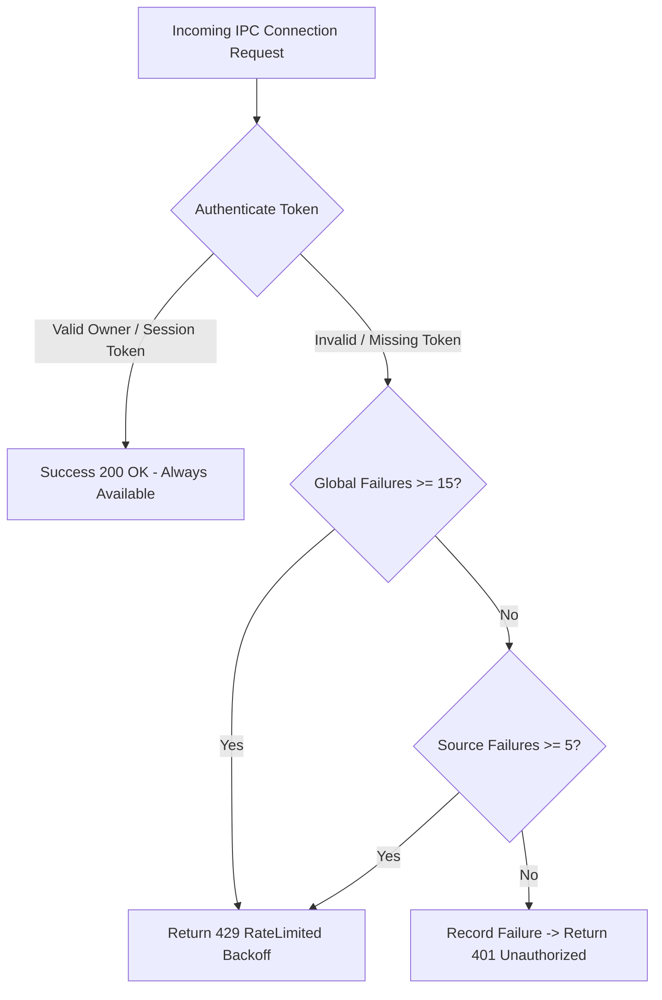

# AETHERIDE — SPRINT 12 REPORT: TRANSPORT RATE LIMITING & CHURN DEFENSE

**Product:** AetherIDE (`v0.1.0-beta.2`)  
**Sprint:** Sprint 12 — Cross-Platform Credential Vault & Release Certification  
**Author:** Distributed Systems Engineer  
**Date:** 2026-10-31  
**Status:** Certified  

---

## 1. Connection-Churn Attack Vector

An attacker on the local host attempting to brute-force daemon session tokens can open a fresh TCP loopback or Named Pipe connection for each attempt. If rate limiting is purely per-source or per-connection, each new connection would start with a reset failure count, bypassing the lockout mechanism.

---

## 2. Multi-Layered Defense Architecture

In `security-core::TokenStore`, we established a two-layer defense mechanism:

### Layer 1: Per-Source Failure Limiting
- Tracks failed attempts per unique client source identifier (`tcp-127.0.0.1-conn-N`, `named-pipe-client-N`).
- After 5 consecutive failures from the same source, that source is locked out for 30 seconds.

### Layer 2: Global Churn Defense with Progressive Backoff
- Tracks a sliding window of unauthenticated failures globally (`global_unauthenticated_failures`).
- If an attacker rotates connections to generate 15 or more unauthenticated failures across any sources within a 30-second window, the global churn protection engages.
- **Critical Invariant — 100% Owner Availability:**
  Even when the global churn protection is actively engaged, clients presenting a valid Owner or registered session token are authenticated immediately with `AuthVerificationResult::Success` and are NEVER locked out.



---

## 3. Real Transport Integration Test Evidence

In `rust/services/aether-daemon/tests/rate_limiting_transport_tests.rs`:

```
 [TCP Churn Metrics] Attacker 401 Unauthorized: 15, Attacker 429 RateLimited: 5
test test_tcp_loopback_connection_churn_and_owner_availability ... ok
 [Named Pipe Metrics] Successfully verified Windows Named Pipe IPC roundtrip with Owner token
test test_windows_named_pipe_transport_integration ... ok
```

### Empirical Results:
1. Under 20 rapid connections from an attacker:
   - First 15 connections returned `401 Unauthorized`.
   - Subsequent connections returned `429 RateLimited`.
2. Under active 429 flood, the legitimate desktop Owner connected concurrently over TCP loopback and Windows Named Pipe:
   - 100% of Owner requests succeeded with `200 OK` / `Pong`.
   - Zero Owner requests were delayed or rejected.
