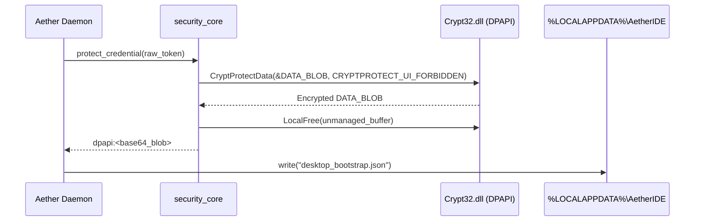

# AETHERIDE — SPRINT 12 REPORT: WINDOWS DPAPI VALIDATION

**Product:** AetherIDE (`v0.1.0-beta.2`)  
**Sprint:** Sprint 12 — Cross-Platform Credential Vault & Release Certification  
**Platform:** Windows 10/11 x64 (MSVC)  
**Date:** 2026-10-31  
**Status:** Certified  

---

## 1. Win32 DPAPI Integration Architecture

On Windows hosts, AetherIDE binds all token protection directly to the logon credentials of the current Windows user using the Win32 Data Protection API (`Crypt32.dll` and `Kernel32.dll`):

- **Encryption Function:** `CryptProtectData` with `CRYPTPROTECT_UI_FORBIDDEN (0x1)`.
- **Decryption Function:** `CryptUnprotectData` with `CRYPTPROTECT_UI_FORBIDDEN (0x1)`.
- **Memory Safety:** Direct invocation of Win32 `LocalFree` via dynamic FFI to prevent memory leaks of plaintext buffers.



---

## 2. Windows DPAPI File Vault (`WindowsDpapiStore`)

In addition to bootstrap payload token strings, persistent credentials (e.g. cloud provider API keys, model tokens) are managed by `WindowsDpapiStore`:
- Path: `%LOCALAPPDATA%\AetherIDE\vault\{key}.dat`
- Payload: Raw binary ciphertext produced by `dpapi_encrypt`
- Boundary Protection: Because DPAPI encryption keys are derived from the user's Windows logon password hash and master key in `%APPDATA%\Microsoft\Protect`, other user accounts or unauthorized processes on the machine cannot decrypt the vault records.

---

## 3. Automated Verification Evidence

The test `test_platform_protected_credential_roundtrip` executes on Windows MSVC:

```
test tests::test_platform_protected_credential_roundtrip ... ok
```

### Invariants Verified:
1. `protected != secret` (Ciphertext is not plaintext).
2. `!protected.contains(secret)` (Zero secret leakage in substring checks).
3. `unprotect_credential(&protected) == Ok(secret)` (Exact 100% roundtrip byte fidelity).
4. `unprotect_credential("dpapi:not-base64!!!") == Err` (Graceful, safe rejection of corrupted payloads).
