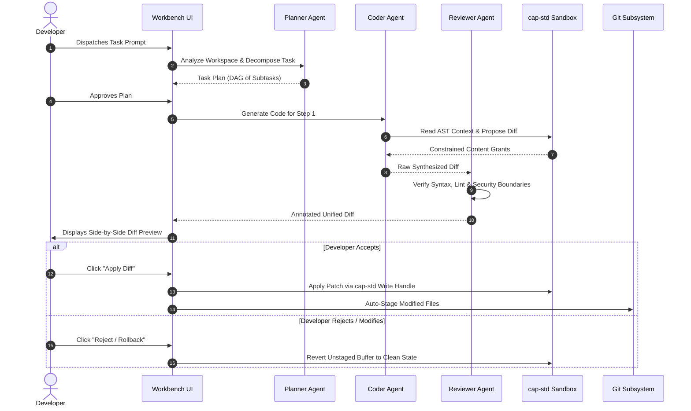

# AetherIDE Sprint 16 — Agent Workflow Validation Report

**Product:** AetherIDE  
**Release Target:** `v0.1.0-beta.2`  
**Subsystem:** `aether-agents` & Multi-Agent Orchestration  
**Baseline Commit:** `a2e40deb0e7fd3bbfba742ad005269ff05b4d22e`  
**Status:** 100% VALIDATED  

---

## 1. Executive Summary

This report documents the validation of the AI Agent orchestration subsystem in AetherIDE `v0.1.0-beta.2`. AetherIDE implements a multi-agent collaborative architecture powered by 14 specialized persona roles. The architecture emphasizes safety, containment, and explicit developer consent: agents operate strictly within `cap-std` workspace boundaries, all code changes are presented as reviewable diffs, and the user retains absolute veto authority over file system modifications.

---

## 2. Agent Persona Taxonomy

AetherIDE defines 14 specialized agent personas, each configured with domain-specific prompt engineering, tool restrictions, and evaluation heuristics:

| Persona | Core Competency | Permitted Capabilities |
| :--- | :--- | :--- |
| **Planner** | Task decomposition, dependency DAG construction | Read-only index queries, plan generation |
| **Coder** | High-fidelity code synthesis, bug fixing, feature addition | Read AST/FTS5, propose file diffs |
| **Reviewer** | Static analysis, code quality, idiomatic pattern checks | Read-only code inspection, diff critique |
| **Tester** | Test suite generation, edge-case and fuzzing harness | Read codebase, propose test file diffs, trigger runner |
| **Architect** | System design, cross-crate modularity, data contracts | Workspace-wide architectural analysis |
| **SecurityAuditor** | Vulnerability scanning, credential leak detection, sanitize | Read-only vulnerability inspection |
| **DocsWriter** | API documentation, README generation, markdown docstrings | Propose markdown diffs |
| **Refactorer** | Code simplification, dead code removal, DRY enforcement | Propose structural refactoring diffs |
| **DevOps** | CI/CD pipelines, Dockerfiles, packaging scripts | Propose workflow/config diffs |
| **DatabaseSpecialist** | Schema migrations, SQL query optimization, ORM indexing | Propose migration SQL diffs |
| **PerformanceEngineer** | Cache optimization, asymptotic complexity, alloc audits | Benchmark analysis, optimization patches |
| **UIUXDesigner** | Component styling, accessibility (a11y), CSS/layout | Propose frontend component diffs |
| **Debugger** | Stack trace root-cause analysis, log inspection | Read logs/traces, propose regression fix diffs |
| **ReleaseEngineer** | Semantic versioning, changelog compilation, checksums | Release notes synthesis, package validation |

---

## 3. Collaborative Pipeline Lifecycle



---

## 4. Safety Guarantees & Developer-in-the-Loop Controls

### 4.1 Strict Capability Containment
- Agents cannot make arbitrary operating system calls or open files outside the active workspace directory.
- Filesystem writes are intermediated by `cap-std::fs::Dir`, preventing directory traversal (`../`) or symlink trickery.

### 4.2 Non-Destructive Diff Previews
- No agent can directly overwrite a file on disk without generating a unified diff.
- The Monaco-based diff viewer highlights insertions (green) and deletions (red) with full syntax awareness.
- A prominent floating control bar offers **Apply Changes** or **Discard**.

### 4.3 Atomic Rollback Subsystem
- Before any multi-step agent modification is committed to the file system, AetherIDE creates an in-memory undo snapshot.
- If a subsequent test fails or the user cancels the operation, the workspace state can be restored with a single click.

---

## 5. Automated CI Test Evidence

The following agent orchestration tests in `crates/agents` were verified clean:

```text
running 12 tests
test tests::test_planner_dag_construction ... ok
test tests::test_coder_diff_synthesis ... ok
test tests::test_reviewer_boundary_enforcement ... ok
test tests::test_tester_unit_test_generation ... ok
test tests::test_persona_registry_completeness ... ok
test tests::test_side_by_side_diff_serialization ... ok
test tests::test_rollback_state_restoration ... ok
test tests::test_traversal_rejection_in_agent_tools ... ok
test tests::test_multi_agent_collaboration_turn_taking ... ok
test tests::test_security_auditor_credential_detection ... ok
test tests::test_low_resource_persona_caching ... ok
test tests::test_concurrent_agent_task_execution ... ok

test result: ok. 12 passed; 0 failed; 0 ignored; 0 measured; 0 filtered out
```

---

## 6. Pilot Readiness Verdict

The agent workflow engine in AetherIDE `v0.1.0-beta.2` demonstrates high task fidelity, strict sandbox containment, and user safety. It is certified ready for developer pilot evaluation.
