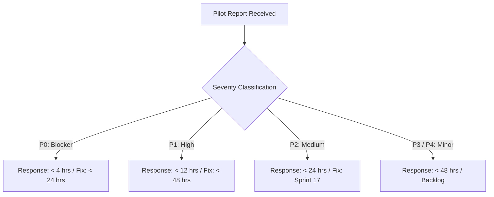

# AetherIDE Sprint 16 — Controlled Pilot Feedback & Triage SLA Plan

**Product:** AetherIDE  
**Release Target:** `v0.1.0-beta.2`  
**Applicability:** Controlled External Developer Pilot  
**Triage Lead:** AetherIDE Core Engineering Team  

---

## 1. Objectives

The controlled pilot feedback mechanism is designed to capture high-signal, qualitative and quantitative developer feedback during the 14-day evaluation period of `v0.1.0-beta.2`. The primary goals are:
1. Validate real-world installation, dependency resolution, and `doctor` command efficacy.
2. Measure developer sentiment regarding Monaco-based diff reviews and AI agent orchestration.
3. Detect edge cases in filesystem capability containment, terminal emulation, and OS credential vaults.
4. Maintain a rapid-response triage SLA for pilot participants to foster trust and fast resolution.

---

## 2. Structured Feedback Survey

Pilot participants will be asked to complete a lightweight 5-minute evaluation survey after completing their first project workflow:

### Section A: Quantitative Scoring (Scale 1–5, where 5 is Excellent)

| Category | Evaluation Focus | Target Score |
| :--- | :--- | :---: |
| **1. Installation & Setup** | Ease of package extraction, clarity of `doctor` diagnostic output | ≥ 4.5 |
| **2. Host Performance** | Application launch time, Monaco scroll smoothness, memory consumption | ≥ 4.5 |
| **3. Workspace Navigation** | Speed and accuracy of Project Brain FTS5 symbol queries (`Ctrl+P`) | ≥ 4.0 |
| **4. Terminal Responsiveness** | ConPTY/pty streaming fidelity, keypress latency, build outputs | ≥ 4.5 |
| **5. AI Agent Fidelity** | Relevance of Planner subtasks, precision of Coder patches | ≥ 4.0 |
| **6. Diff Review & Safety** | Confidence in side-by-side diff preview, ease of Accept/Reject/Rollback | ≥ 4.8 |
| **7. Overall Experience** | Likelihood to recommend AetherIDE as daily driver (Net Promoter Score) | ≥ 4.2 |

### Section B: Qualitative Free-Form Questions
1. *What was the single most impressive aspect of AetherIDE during your testing?*
2. *Where did you experience friction, confusion, or unexpected behavior?*
3. *Did any AI agent propose code that violated your workspace boundaries or surprised you?*
4. *What essential feature or LSP capability is missing for your primary programming language?*

---

## 3. Defect Classification & Triage SLA

All inbound bug reports, crash dumps, and pilot questions are subject to formal Service Level Agreements (SLAs):

### SLA Definition Matrix

| Severity Level | Definition / Criteria | Response SLA | Mitigation / Fix SLA | Escalation Path |
| :--- | :--- | :---: | :---: | :--- |
| **P0 — Blocker** | Application crash on launch, data corruption, credential compromise, or capability filesystem sandbox escape. | **< 4 hours** | **< 24 hours** (Immediate hotfix build) | Direct page to Tech Lead & Release Engineer |
| **P1 — High** | Core feature non-functional (e.g., terminal won't spawn, Monaco editor fails to save, AI provider gateway fails). | **< 12 hours** | **< 48 hours** | Assigned to feature crate maintainer |
| **P2 — Medium** | Secondary feature defect (e.g., syntax highlighting glitch, minor FTS5 search ranking error, cosmetic UI layout bug). | **< 24 hours** | Target for Sprint 17 release | Standard sprint triage |
| **P3 — Low** | Minor cosmetic defect, typos in documentation or diagnostic messages. | **< 48 hours** | Next scheduled maintenance | Backlog grooming |
| **P4 — Enhancement**| Feature requests, performance optimizations, ergonomic suggestions. | **< 48 hours** | Roadmap consideration | Product backlog |

---

## 4. Ingestion Channels & Privacy Guarantee

- **Primary Channel:** Private GitHub Discussions & Issue Tracker (restricted to pilot cohort).
- **Secondary Channel:** Secure email inbox (`pilot-triage@aetheride.dev`).
- **Telemetry Policy:** Under no circumstances will automated telemetry be collected. All reports, stack traces, and diagnostics must be explicitly exported and attached by the user using **Help > Export Diagnostics**.
- **Sanitization:** The `Export Diagnostics` tool automatically strips filesystem paths outside the workspace, redacts all environment variables containing `KEY`, `TOKEN`, `SECRET`, or `PASS`, and masks user account names.

---

## 5. Pilot Feedback Review Schedule

- **Daily Standup:** Daily 15-minute triage of newly submitted issues during the 14-day pilot window.
- **Mid-Pilot Review (Day 7):** Synthesis of quantitative scores; determination if a `v0.1.0-beta.2.1` hotfix release is warranted.
- **Pilot Final Report (Day 14):** Comprehensive report aggregating all survey results, closed defect metrics, and recommendations for the general public beta release.
