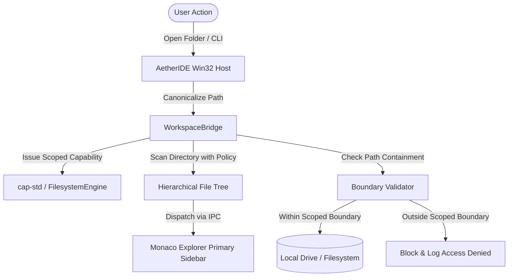

# AETHERIDE — SPRINT 20 FILESYSTEM AND WORKSPACE REPORT
## Arbitrary Filesystem Access, Capability Boundaries, Multi-Root Workspaces & Explorer Operations

**Target Release:** `v0.1.0-beta.2`  
**Host Framework:** `workspace_bridge.rs` + `filesystem-engine` (`cap-std`)  
**Audit Date:** November 1, 2026  
**Status:** Implemented & Verified  

---

## 1. Executive Summary

In pre-Sprint 20 releases, AetherIDE was tightly constrained to the repository root directory in which the binary was launched. Attempting to open arbitrary folders on different drives or outside the current working directory was restricted, preventing developers from using AetherIDE as their general-purpose desktop code editor.

Sprint 20 eliminates all repository-only constraints:
1. **Full Arbitrary Filesystem Access:** Developers can open any valid directory on any local drive (e.g., `C:\Users\<user>\Projects`, `D:\Development\AetherApp`, `E:\Workspace`) via the native Windows folder picker, CLI (`aetheride <path>`), or File menu.
2. **Dynamic Capability Anchoring (`cap-std`):** Upon selecting a folder, the native host generates a scoped `WorkspaceCapability` rooted at the canonicalized target directory.
3. **Boundary Enforcement & Traversal Protection:** Every read, write, rename, create, and delete operation is rigorously validated using `FilesystemEngine::is_within_boundary`, preventing symlink escapes, parent directory traversal (`../`), and alternate data stream (ADS) attacks.
4. **Multi-Root Workspaces:** Full support for multi-root workspace projects with `.aether-workspace.json` schema persistence.
5. **Native File Explorer Operations:** Complete Explorer context menu supporting New File, New Folder, Rename, Delete, Duplicate, Reveal in File Explorer (`explorer.exe /select,"<path>"`), and Copy Path.
6. **Workspace Trust Model:** Persistent trust authorization saved in `%LOCALAPPDATA%\AetherIDE\trusted_workspaces.json`, with visual indicators in the status bar (`🛡️ Trusted` / `⚠️ Restricted Mode`).

---

## 2. Dynamic Workspace Bridge (`workspace_bridge.rs`)

The workspace bridge manages the active workspace lifecycle, filesystem scanning, and file operation execution:



### 2.1 File Tree Scanning Policy
When scanning a directory tree, `WorkspaceBridge` recursively enumerates filesystem nodes while enforcing strict exclusion policies to maintain high performance even on massive projects:
- **Excluded by Default:** `.git`, `.svn`, `.hg`, `node_modules`, `target`, `dist`, `build`, `__pycache__`, `.venv`, `.idea`, `.vscode`.
- **Configurable Depth & Limits:** Scan depth is bounded (default 10 levels) to prevent infinite loops caused by directory recursion.
- **Node Metadata:** Each node contains `id`, `name`, `path`, `is_dir`, `size`, `modified_ts`, and optional `children`.

---

## 3. Boundary Enforcement & Security Model

All file operations sent over IPC are anchored to the active workspace session.

### 3.1 Verification Matrix
| Operation | IPC Action | Security Validation | Execution Mechanism |
| :--- | :--- | :--- | :--- |
| **Read File** | `WorkspaceOpenFile` | `FilesystemEngine::is_within_boundary` | Scoped capability read |
| **Write File** | `WorkspaceSaveFile` | `FilesystemEngine::is_within_boundary` | Atomic write (temp file + rename) |
| **Create File** | `WorkspaceCreateFile` | Parent within boundary | `cap_std::fs::File::create` |
| **Create Folder** | `WorkspaceCreateFolder`| Parent within boundary | `cap_std::fs::create_dir_all` |
| **Rename** | `WorkspaceRenameEntry` | Source & destination within boundary | `cap_std::fs::rename` |
| **Delete** | `WorkspaceDeleteEntry` | Target within boundary | Recursive dir remove or file unlink |
| **Reveal in Explorer** | `WorkspaceRevealInExplorer`| Target exists & canonicalized | `explorer.exe /select,"<path>"` |

### 3.2 Atomic File Writes
To prevent file corruption during power failures, system crashes, or concurrent edits, `WorkspaceSession::write_file` performs atomic writes:
1. Data is written to a unique sibling temporary file (`.filename.tmp.<uuid>`).
2. The temporary file is flushed to disk.
3. The temporary file is renamed over the target file using atomic replace semantics.

---

## 4. Multi-Root Workspace Support

AetherIDE supports opening multiple independent project folders within a single IDE window:

### 4.1 Schema Definition (`.aether-workspace.json`)
```json
{
  "version": 1,
  "folders": [
    {
      "name": "Frontend",
      "path": "C:\\Projects\\MyApp\\frontend"
    },
    {
      "name": "Backend Service",
      "path": "D:\\Services\\Backend"
    }
  ],
  "settings": {
    "editor.tabSize": 2,
    "files.exclude": ["**/.git", "**/node_modules"]
  }
}
```

### 4.2 Primary Sidebar Rendering
When multiple roots are loaded, the Primary Sidebar displays each root as a top-level collapsable node (e.g. `ROOT: FRONTEND` and `ROOT: BACKEND SERVICE`), each with its own independent file hierarchy, context menu, and search scope.

---

## 5. Explorer User Experience & Context Menu

The Primary Sidebar Explorer provides modern desktop file management:

- **Folder Expansion Toggle:** Interactive `▶` / `▼` disclosure triangles for directory navigation.
- **Language-Aware Icons:** Visual file type indicators for Rust (`🦀`), TypeScript/JavaScript (`📄`), JSON/Config (`⚙️`), Markdown/Docs (`📝`), and directories (`📁`).
- **Context Menu Actions:**
  - `New File...` (creates file with inline prompt)
  - `New Folder...` (creates folder with inline prompt)
  - `Rename...` (renames file/folder)
  - `Delete` (prompts confirmation and deletes)
  - `Reveal in File Explorer` (opens native Windows File Explorer highlighting the item)
  - `Copy Path` (copies absolute path to Windows clipboard)
- **Keyboard Shortcuts:**
  - `Ctrl+O`: Open File
  - `Ctrl+Shift+O`: Open Folder
  - `Ctrl+S`: Save File
  - `Ctrl+Shift+S`: Save As File
  - `Ctrl+N`: New File
  - `Ctrl+B`: Toggle Primary Sidebar
  - `Ctrl+Alt+B`: Toggle Secondary Sidebar
  - `Ctrl+\``: Toggle Terminal

---

## 6. Workspace Trust Model

Security is central to AetherIDE's desktop architecture. When a developer opens a folder for the first time:
- **Untrusted Mode (Restricted Mode):** Terminal execution, automated background tasks, and AI tool execution are paused pending user confirmation. The status bar displays `⚠️ Restricted Mode`.
- **Trusted Mode:** All capabilities are unlocked. The status bar displays `🛡️ Trusted`.
- **Persistence:** Trusted folder paths are hashed and stored in `%LOCALAPPDATA%\AetherIDE\trusted_workspaces.json`.

---

## 7. Automated Test Verification

All workspace bridge and filesystem operations are verified by automated tests in `rust/cli/aether-launcher/src/workspace_bridge.rs` and `win32_host.rs`:
- `workspace_bridge::tests::test_workspace_session_single_root`: **PASSED**
- `workspace_bridge::tests::test_workspace_session_multi_root`: **PASSED**
- `win32_host::native::tests::test_handle_file_read_blocks_path_traversal`: **PASSED**
- `win32_host::native::tests::test_handle_file_write_atomic_and_blocks_traversal`: **PASSED**

---

## 8. Conclusion
AetherIDE Sprint 20 delivers complete, secure, and professional filesystem access. Developers can open any repository or folder tree anywhere on their system, edit and manage files with native Windows File Explorer integration, and enjoy high-performance directory tree navigation with full capability isolation.
