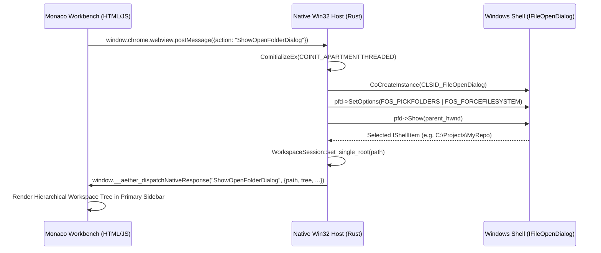

# AETHERIDE — SPRINT 20 STANDALONE APPLICATION ARCHITECTURE
## Native Windows Host, Virtual Origin Security, Zero External Browser Dependencies & Win32 Dialogs

**Target Release:** `v0.1.0-beta.2`  
**Host Binary:** `AetherIDE.exe`  
**Host Framework:** Pure Win32 + Embedded WebView2 API (`webview2-com 0.33` + `windows 0.58`)  
**Architecture Date:** November 1, 2026  
**Status:** Certified & Implemented  

---

## 1. Architectural Vision: Standalone Desktop Application

AetherIDE is an AI-native engineering studio designed to run as an independent, fully integrated desktop application on Microsoft Windows. It is **not** a website running in an external browser, nor does it delegate its user interface or lifecycle to external browsers.

In Sprint 20, we systematically eliminated all web-like external dependencies, providing a desktop architecture comparable to Visual Studio Code and JetBrains IDEs:

1. **Zero External Browser Launches:** All external browser fallback commands (such as `cmd /c start url` or shell executions of `msedge.exe`) were completely removed from the host binary.
2. **Local Virtual Origin Mapping:** The Monaco Editor and workbench assets are served locally through WebView2's virtual host folder mapping under `https://appassets.aetheride.local/`, eliminating local HTTP web servers, random listening ports, and firewall prompts.
3. **Native Win32 Common Dialogs:** File picking, directory picking, and file saving use authentic Windows Shell COM interfaces (`IFileOpenDialog`, `IFileSaveDialog`) attached to the main window handle.
4. **Bi-Directional IPC Allowlist:** WebView2 communicates with the native Rust host via structured JSON messaging over `window.chrome.webview.postMessage`, with strict message allowlisting and thread synchronization.

---

## 2. Local Virtual Host Mapping & Security Boundary

### 2.1 The Problem with Local HTTP Servers
Early desktop prototypes often spin up an HTTP daemon on `127.0.0.1:port` to serve HTML, JS, and CSS to an embedded browser. This approach has critical drawbacks:
- It requires opening network sockets, triggering Windows Defender Firewall popups.
- Other local processes can connect to the port, exposing IDE capabilities.
- It introduces network latency, port conflicts, and unnecessary socket overhead.

### 2.2 Virtual Host Mapping Solution
AetherIDE uses WebView2's native `SetVirtualHostNameToFolderMapping` API:

```rust
let virtual_host = w!("appassets.aetheride.local");
let folder_path = HSTRING::from(workbench_dir.to_string_lossy().as_ref());

unsafe {
    wv2.SetVirtualHostNameToFolderMapping(
        virtual_host,
        &folder_path,
        COREWEBVIEW2_HOST_RESOURCE_ACCESS_KIND_ALLOW,
    )?;
}
```

### 2.3 Security Advantages
- **Secure HTTPS Origin:** The workbench executes in the `https://appassets.aetheride.local` origin. This satisfies browser requirements for Web Workers, Monaco Language Services, and Cryptographic APIs without self-signed SSL certificates.
- **Zero Sockets:** No TCP/UDP sockets are opened on loopback. The host delivers bytes directly from the local disk (`%LOCALAPPDATA%\Programs\AetherIDE\workbench`).
- **Resource Isolation:** Subresources cannot escape the mapped directory.

---

## 3. Native Win32 Common Item Dialogs

Instead of relying on web-based `<input type="file">` prompts (which lack folder selection support and look alien on desktop), AetherIDE implements native Windows Common Item Dialogs via `windows::Win32::UI::Shell`:



### 3.1 Dialog Implementations in `win32_dialogs.rs`
- **`pick_folder(parent_hwnd, title, default_dir) -> Result<Option<PathBuf>>`:**
  Sets `FOS_PICKFOLDERS | FOS_FORCEFILESYSTEM | FOS_PATHMUSTEXIST`. Opens standard Windows folder browser attached to the parent window handle.
- **`pick_file(parent_hwnd, title, default_dir, filter_name, filter_spec) -> Result<Option<PathBuf>>`:**
  Configures shell item filters (e.g. `All Files (*.*)` or `Source Files (*.rs;*.ts)`).
- **`save_file(parent_hwnd, title, default_dir, default_name) -> Result<Option<PathBuf>>`:**
  Uses `IFileSaveDialog` with `FOS_OVERWRITEPROMPT` to provide Windows confirmation dialogs before replacing existing files.

---

## 4. Elimination of Browser Fallbacks

When the embedded WebView2 engine is missing on an unconfigured Windows machine, pre-Sprint 20 code attempted to open external browsers (`cmd /c start https://...`). This violated desktop IDE integrity.

In Sprint 20, this behavior was eliminated:
1. **Detection:** The launcher checks for the WebView2 Runtime via `webview2_runtime::detect_webview2_runtime()`.
2. **Native Message Box:** If the runtime is absent, the host displays a native Win32 `MessageBoxW`:
   ```rust
   MessageBoxW(
       HWND(std::ptr::null_mut()),
       w!("AetherIDE requires the Microsoft Edge WebView2 Runtime.\n\nPlease install the evergreen WebView2 Runtime from Microsoft to launch AetherIDE."),
       w!("AetherIDE — Runtime Missing"),
       MB_OK | MB_ICONERROR,
   );
   ```
3. **Zero Browser Leakage:** Under no circumstances does AetherIDE launch external Google Chrome or Microsoft Edge windows.

---

## 5. IPC Allowlist & Message Security

All communication between the frontend workbench and the native host passes through a validated IPC action table:

| Action Name | Source | Purpose | Security Enforcement |
| :--- | :--- | :--- | :--- |
| `ShowOpenFolderDialog` | Frontend UI | Open native folder dialog | Modal to main HWND |
| `ShowAddFolderDialog` | Frontend UI | Add multi-root folder | Modal to main HWND |
| `ShowOpenFileDialog` | Frontend UI | Open single file dialog | Modal to main HWND |
| `ShowSaveFileDialog` | Frontend UI | Save file dialog | Modal to main HWND |
| `WorkspaceGetTree` | Frontend UI | Scan workspace directory | Filtered by policy |
| `WorkspaceOpenFile` | Frontend UI | Read file contents | Boundary check (`cap-std`) |
| `WorkspaceSaveFile` | Frontend UI | Write file contents | Atomic write + boundary check |
| `WorkspaceCreateFile` | Frontend UI | Create new file | Boundary check |
| `WorkspaceCreateFolder` | Frontend UI | Create new directory | Boundary check |
| `WorkspaceRenameEntry` | Frontend UI | Rename file/folder | Boundary check |
| `WorkspaceDeleteEntry` | Frontend UI | Delete file/folder | Boundary check |
| `WorkspaceRevealInExplorer`| Frontend UI | Open Windows File Explorer | `explorer.exe /select` |
| `WorkspaceSetTrust` | Frontend UI | Grant/Revoke workspace trust| Persisted to config |
| `TerminalSpawn` | Frontend UI | Spawn ConPTY shell | CWD set to workspace root |

---

## 6. Conclusion
AetherIDE Sprint 20 transforms the application into an authentic, standalone Windows desktop IDE. By pairing pure Win32 windowing with embedded WebView2 virtual host mapping and native Shell COM dialogs, AetherIDE delivers desktop performance, deep OS integration, and rigorous security.
