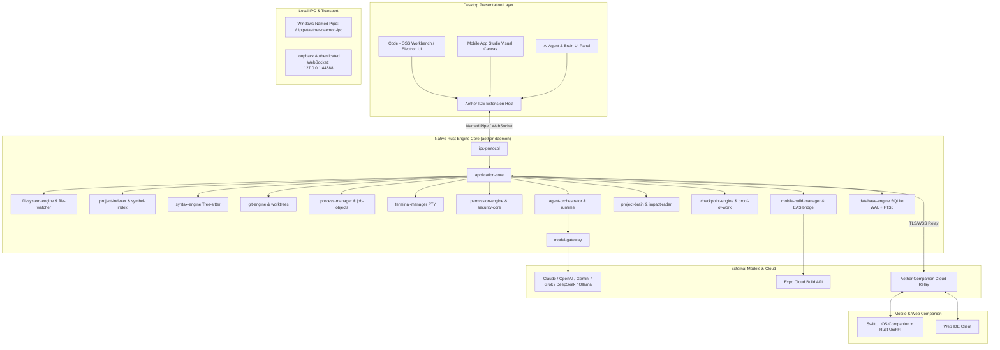

# AetherIDE — Technical Architecture Specification

## 1. System Topology Overview



---

## 2. Component Deconstruction

### 2.1 Native Rust Daemon (`rust/services/aether-daemon`)
- **Runtime:** Tokio multithreaded runtime with work-stealing threadpool tuned to logical CPU core count.
- **Process Boundaries:** Completely out-of-process from the Electron/Code - OSS renderer and Node.js extension host. Crash isolation ensures a UI crash does not terminate long-running indexing, build jobs, or agent tasks.
- **IPC Interface:**
  - Fast binary/JSON-RPC framing over Windows Named Pipes (`\\.\pipe\aether-daemon-ipc`).
  - Fallback local WebSocket for browser web workspace and internal devtools.
  - Mutual session token generated per launch and exchanged via temporary secure memory file.

### 2.2 Project Indexing & Symbol Graph (`project-indexer`, `symbol-index`)
- **Incremental Ingestion:** `notify` events feed an in-memory queue with 150ms debouncing.
- **AST Parsing:** Multi-language Tree-sitter parsers parse modified source buffers into concrete syntax trees.
- **Symbol Extraction:** Functions, structs, classes, traits, interfaces, endpoints, and variables are extracted and stored in SQLite tables with FTS5 indexing.
- **Graph Storage:** Directed graph (`petgraph`) tracks dependencies, caller/callee relationships, import paths, and API schemas.

### 2.3 Universal AI Model Gateway (`model-gateway`)
- **Provider Agnostic Trait:** `ModelProvider` trait defines `complete()`, `stream_complete()`, `list_models()`, `count_tokens()`, and `validate_credentials()`.
- **Adapters Implemented:**
  - Anthropic: Claude Messages API with SSE streaming.
  - OpenAI: Chat Completions API with function/tool calls.
  - Google Gemini: Content API with Gemini 1.5/2.0/3.8 protocols.
  - xAI Grok: Grok API adapter.
  - DeepSeek: DeepSeek-V3 and DeepSeek-R1 reasoning protocol.
  - Ollama & LM Studio: Native local endpoints.
- **Rate-Limiter & Exponential Backoff:** Token bucket limiter preventing 429 errors and managing retry budgets.

### 2.4 Autonomous Agent Orchestrator (`agent-orchestrator`, `agent-runtime`)
- **Execution Loop:** Plan -> Verify Permissions -> Stage Diffs -> Execute in Git Worktree -> Run Tests -> Verify Output -> Commit/Reject.
- **Parallel Worktrees:** Each parallel agent receives an isolated Git worktree:
  ```
  .git/worktrees/agent-<uuid>
  ```
- **Proof of Work Ledger:** Append-only SQLite journal recording all prompt hashes, tool execution stdout/stderr, generated diffs, and test assertions.

### 2.5 Mobile App Studio Engine (`mobile-build-manager`)
- **Project Generators:**
  - React Native + Expo (TypeScript + Expo Router + NativeWind/Tailwind)
  - Flutter (Dart + Material 3)
  - Android Native (Kotlin + Jetpack Compose)
  - iOS Native (Swift + SwiftUI)
- **EAS Cloud Integration:** Native CLI wrapper and REST API integration for `eas build` triggering Android AAB/APK and iOS IPA builds with artifact download polling.
- **Visual Screen Designer:** Two-way synchronization between JSX AST and visual drag-and-drop canvas.

### 2.6 Desktop Workbench Integration (`apps/desktop`)
- Native integration packaging Code - OSS with custom Aether branding, dark/light technical design system, embedded terminal profiles, and the Aether Core extension communicating directly with `aether-daemon`.

---

## 3. Data Storage & Schema Design

SQLite Database: `.aether/aether.db` (WAL mode enabled, foreign keys ON).

### Core Tables:
1. `symbols`: `(id, file_path, name, kind, line_start, line_end, signature, hash)`
2. `symbol_fts`: SQLite FTS5 virtual table indexing symbol signatures and docstrings.
3. `dependencies`: `(source_file, target_file, relationship_type)`
4. `agent_tasks`: `(id, role, autonomy_mode, objective, status, worktree_path, created_at, finished_at)`
5. `proof_of_work`: `(id, task_id, step_index, tool_name, input_json, output_json, diff, exit_code, timestamp)`
6. `project_brain_nodes`: `(node_id, label, node_type, metadata_json)`
7. `project_brain_edges`: `(source_node, target_node, edge_type, weight)`
8. `credentials_vault`: Encrypted DPAPI blob on Windows for API keys.
